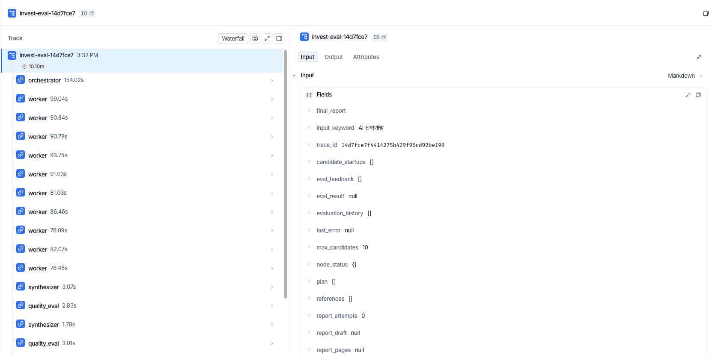
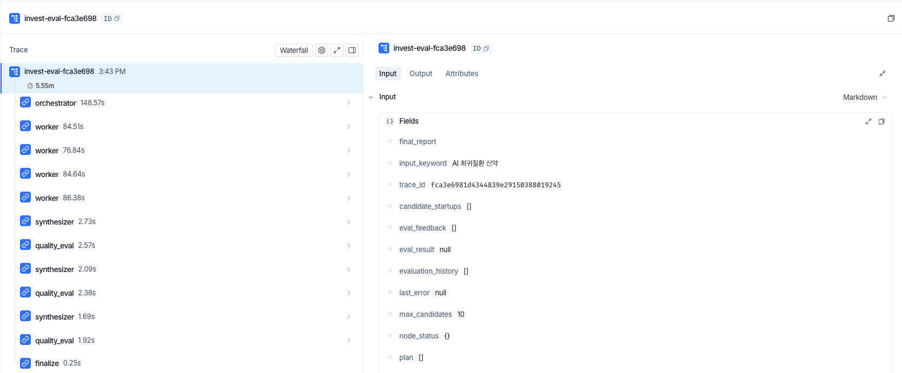
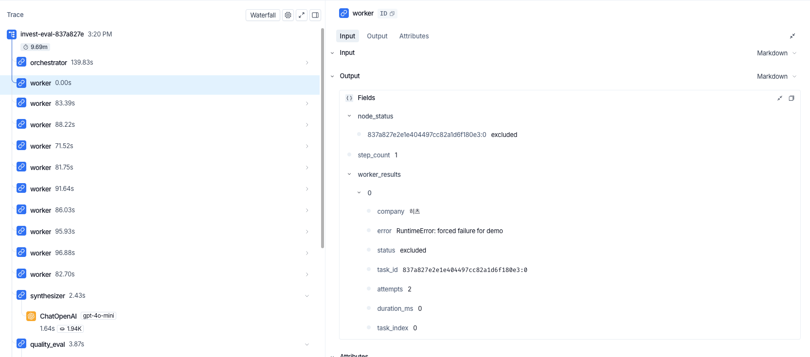
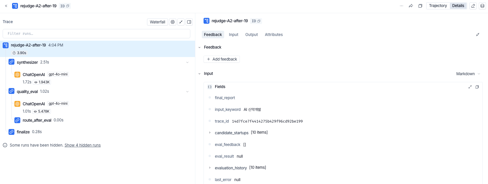
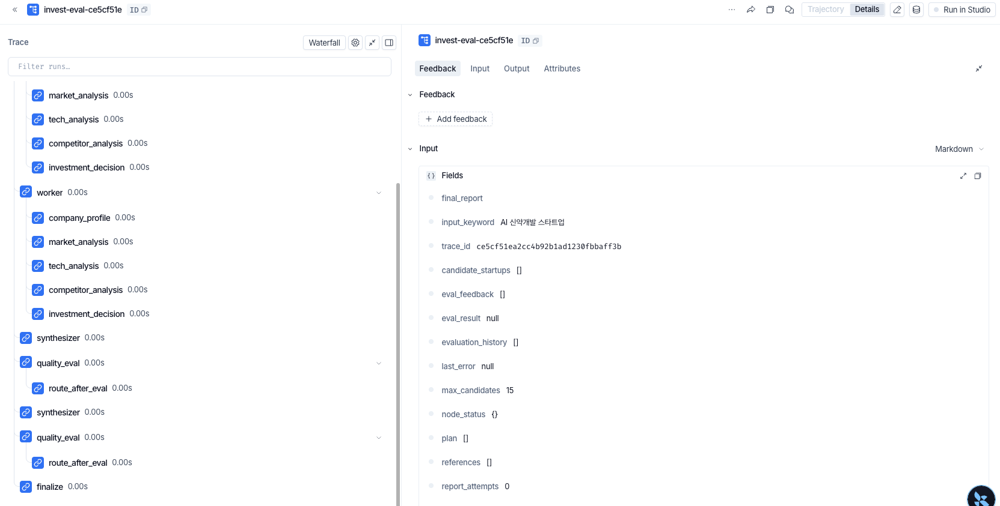

# AI 신약개발 스타트업 투자 평가 에이전트 — Orchestrator-Workers

## 1. Overview

| 항목 | 내용 |
|---|---|
| Subject | AI 신약개발 스타트업 투자 심사 보고서 자동 생성 |
| Objective | 키워드로 찾은 후보 기업을 같은 기준으로 평가하고, 순위·판정과 근거를 담은 보고서(최대 10쪽)를 만든다 |
| Pattern | **Orchestrator-Workers** (LangGraph `Send` 기반 Dynamic Fan-out) |
| 이전 구조 | 후보를 한 곳씩 순차 반복 (1 → 2 → 3A·3B → 4 → 5 → 1 → … → 6) |
| 이번 구조 | 계획 수립 → 후보 수만큼 Worker 병렬 실행 → 집계 → 품질 평가 루프 → 최종 저장 |

초기 바이오 기업은 매출만으로 평가하기 어렵다. 신약 후보의 개발 단계, AI 기술의 실제 검증, 제약사 계약, 시장 정의가 투자 판단을 바꾼다. 평가 범위는 국내외 비상장 AI 신약개발 스타트업(Seed~Series C, 대기업 비자회사)이다. **점수 합산·관문·판정·순위는 코드가 결정하고, LLM은 근거 추출과 문장 작성만 맡는다.** 75점 통과선은 팀이 정한 심사 정책이며 실제 수익률을 뜻하지 않는다. 세부 기준은 [투자평가기준 v4](docs/investment_criteria_v4.md), [공통 데이터 계약](docs/data_contracts.md)에 있다.

### 동적 처리가 고정 순서와 다른 점

- **Worker 수가 실행 시점에 정해진다.** 탐색·자격 검증을 통과한 후보 수만큼 `Send`를 만들며, 코드에 Worker 개수 상수가 없다.
- **후보 수가 같은 상한에서도 키워드에 따라 달라진다.** 같은 상한 10에서 `AI 신약개발`은 Worker 10개, `AI 희귀질환 신약`은 4개가 생성됐다(7장).
- **실패한 기업은 전체를 멈추지 않고 제외된다.** 1회 재시도 후에도 실패하면 보고서에 "평가 제외"로 남고 나머지 기업으로 보고서를 만든다.
- **보고서 품질 미달이면 다시 쓴다.** 재작성으로 고칠 수 있는 문제만 루프를 돌고, 상한에 도달하면 멈춘다.

## 2. 패턴 선택 근거

- 후보 기업별 평가(프로필 → 기술·시장 → 경쟁 → 판정)는 **서로 의존하지 않는다.** 그래서 "평가할 후보 목록을 계획 → 후보마다 Worker 병렬 실행 → 결과 집계"로 나누는 Orchestrator-Workers가 문제 구조와 맞는다.
- "작업이 서로 독립적인 N개로 쪼개질 때 Orchestrator가 Supervisor보다 낫다"는 기준에 해당한다. 경쟁사 N곳을 조사해 비교 리포트를 만드는 구조와 같은 형태다.
- **Supervisor를 고르지 않은 이유:** Supervisor는 하나의 대상을 놓고 매 단계 다음 작업을 고르는 데 강점이 있다. 이 과제는 여러 대상에 같은 평가를 하는 구조라 병렬 분할이 더 직접적이고, 기존 2~5번 에이전트를 Worker 내부 흐름으로 그대로 재사용할 수 있다.

## 3. Graph

```mermaid
flowchart TD
    S([START]) --> O[orchestrator<br/>1번 탐색·자격검증 + 계획 수립<br/>+ 인덱스·모델 워밍업]
    O -->|plan 비어 있음| R
    O -->|Send × N<br/>N = len(plan)| W[worker<br/>서브그래프: 2 → 3A·3B → 4 → 5<br/>실패 시 1회 재시도 → 제외]
    W --> R[synthesizer<br/>정렬·집계 + 보고서 초안]
    R --> Q[quality_eval<br/>규칙 + LLM Judge · 판정만]
    Q -->|재작성 가능 & 작성 횟수 < 상한| R
    Q -->|그 외 모든 경우| F[finalize<br/>품질 결과 반영 · 최종 저장]
    F --> E([END])
```

| 노드 | 역할 | 코드 |
|---|---|---|
| `orchestrator` | 1번 탐색·자격 검증 결과로 후보별 `SubTask` 계획 생성. LLM Planner가 후보별 `focus`(검색 우선 확인 사항)를 채움 | [`orchestrator.py`](src/orchestration/orchestrator.py) |
| `dispatch` | `plan` 길이만큼 `Send("worker", …)` 반환. 후보 0개면 바로 synthesizer | [`orchestrator.py`](src/orchestration/orchestrator.py) |
| `worker` | 기업별 서브그래프(2 → 3A·3B 병렬 → 4 → 5). 재시도·제외 처리 | [`worker.py`](src/orchestration/worker.py) |
| `synthesizer` | Worker 결과를 `task_index` 순으로 정렬·집계해 보고서 초안 작성. 품질 피드백 반영 | [`agent6_report.py`](src/agents/agent6_report.py) |
| `quality_eval` | 규칙 검사 + LLM Judge로 판정만 함. 경로는 정하지 않음 | [`quality_eval.py`](src/orchestration/quality_eval.py) |
| `route_after_eval` | LLM 호출 없는 순수 함수로 재작성/종료 결정 | [`routing.py`](src/orchestration/routing.py) |
| `finalize` | 품질 결과 블록 반영, 최종 쪽수 재확인, Markdown·PDF·품질 JSON 저장 | [`finalize.py`](src/orchestration/finalize.py) |

Worker 내부의 하위 에이전트(2, 3-A, 3-B, 4, 5)는 [`src/agents/`](src/agents/)의 기존 노드 함수를 그대로 사용한다.

- Worker끼리는 연결 엣지가 없다. 입력은 `Send` 페이로드(`task`, `trace_id`, `selected_startup`, `analysis_focus`, `references`)뿐이고, 결과는 부모 State의 reducer 필드로만 합쳐진다.
- 같은 superstep의 Worker가 모두 끝난 뒤 synthesizer가 한 번 실행된다.

## 4. Orchestrator-Workers 필수 항목 대응

| 필수 항목 | 구현 방식 | 코드 위치 |
|---|---|---|
| 서브 태스크 목록을 구조화해 State에 저장 | `plan: list[SubTask]` (`task_id`, `task_index`, `company`, `focus`, `discovery_refs`, `max_attempts`). 누구를 평가할지는 코드가, 무엇을 우선 확인할지(`focus`)는 LLM이 정함. LLM 실패 시 `focus=[]` | `orchestrator.py`, `schemas.py` |
| 계획 수립 후 Worker 결정 (Dynamic Fan-out) | `dispatch()`가 `[Send("worker", …) for t in plan]` 반환. Worker 수 상수 없음 | `orchestrator.py`, `graph.py` |
| Worker 결과 누적 + Synthesizer 집계 | `evaluation_history`, `references`, `worker_results`에 `operator.add` reducer. synthesizer가 `task_index` 순으로 정렬 후 집계 | `state.py`, `agent6_report.py` |
| 일부 Worker 실패 시 Fall-back | **1회 재시도 → 실패 시 제외.** 예외를 올리지 않고 `worker_results`에 `status="excluded"`·`error` 기록. 보고서 순위표 아래 "평가 제외(사유)" 표시 | `worker.py` |

`focus`는 장식용이 아니다. Worker 안의 3-A/3-B가 검색 계획 단계에서 이를 검색어 힌트로 사용한다([`rag_analysis.py`](src/agents/rag_analysis.py)).

## 5. State Schema 설계

부모 State는 Input / Working / Eval / Loop 4구역으로 나눴다. 후보별 중간 결과(프로필, 분석 글)는 부모가 아닌 `WorkerState`에만 둔다(Agent Scoping). 병렬 Worker가 같은 단일값 키를 덮어쓰는 문제를 구조적으로 막기 위해서다.

| 구역 | 필드 |
|---|---|
| Input | `input_keyword`, `max_candidates` |
| Working | `candidate_startups`, `plan`, `evaluation_history`⁺, `references`⁺, `worker_results`⁺, `final_report`, `report_draft`, `report_pages` |
| Eval | `eval_result`, `eval_feedback` |
| Loop | `trace_id`, `step_count`⁺, `node_status`⁺, `report_attempts`, `last_error` |

⁺ reducer 보유 (`operator.add` 또는 `merge_dict`)

| 항목 | 설계 | 코드 위치 |
|---|---|---|
| 제어 vs 페이로드 분리 | 4구역 주석 블록으로 분리. 제어 정보(`trace_id`, `step_count`, `node_status`, `report_attempts`, `last_error`)는 Loop 구역에, 작업 결과는 Working 구역에 둠. 기업별 프로필·분석 글·현재 판정은 부모에서 빼고 `WorkerState`로 격리 | `state.py` |
| 관측성 위치 | 결정 로그(계획 근거, 재시도·제외 사유, Worker별 `duration_ms`, 품질 판정·종료 사유)는 State가 아닌 `outputs/trace/{trace_id}.jsonl`과 LangSmith에 기록. State에는 판정 결과와 Worker 결과 요약만. 로그에 쓰기 전 API 키는 `[REDACTED]`로 가림 | `observability.py` |
| 지속성 비용 | 검색 원문·RAG 청크·Tavily 응답은 State에 넣지 않음(탐색 원본은 `outputs/agent1/*.json`). 누적 필드는 기업당 1건이라 `max_candidates`로 크기가 제한됨. `eval_feedback`은 매 판정마다 덮어써 쌓이지 않음 | `agent1_search.py`, `state.py` |
| 상관 | 실행 시작 시 `trace_id = uuid4().hex` 생성 → State, JSONL 로그, LangSmith `metadata.trace_id`, 체크포인트 `thread_id`, 출력 파일명에 공통 사용. 서브 태스크는 `task_id = {trace_id}:{task_index}` | `state.py`, `app.py` |
| 재개/복구 | 부모 체크포인터 `InMemorySaver` + `thread_id=trace_id`, Worker 서브그래프는 `checkpointer=False`로 분리. **같은 프로세스 안에서만** 재개 가능하고 프로세스 재시작 복구는 지원하지 않음. `node_status`에 task별 `done/excluded`, `worker_results[].error`, `last_error` 보존 | `graph.py`, `worker.py` |
| 동시 처리 | 병렬 Worker가 쓰는 부모 키는 전부 reducer 보유. 리스트(`evaluation_history`, `references`, `worker_results`)와 `step_count`는 `operator.add`, `node_status`는 `merge_dict`로 병합. reducer 없는 `last_error`는 Worker가 쓰지 않음(직렬 노드만). `max_concurrency`로 API 한도 보호 | `state.py`, `worker.py`, `app.py` |
| 종료 보장 | ① Worker 재시도 상한 2회 ② API 호출 단위 timeout(LLM 60초·Tavily 30초) ③ 보고서 작성 상한 3회 ④ 재작성 불가 문제만 남으면 즉시 종료 ⑤ `step_count` 상한(`후보 수 × 2 + 10`) ⑥ 부모 `recursion_limit = 24`(Worker 수와 무관). 모든 종료 경로는 `finalize`를 거쳐 `termination_reason` 기록 | `config.py`, `routing.py`, `finalize.py` |

### Fan-out / Fan-in 대응

| 항목 | 대응 |
|---|---|
| 병렬 정합성 | 공유 키는 전부 reducer. 각 Worker는 자기 결과만 반환 |
| 부분 실패 | Worker 안에서 예외를 잡아 재시도 → 제외로 기록하고 그래프는 계속 진행 |
| 동시성 제어 | `max_concurrency` (`WORKER_CONCURRENCY`, 기본 3) |
| 멈춘 브랜치 | API 호출 단위 timeout으로 멈춘 호출이 예외로 끝나게 하고 재시도/제외 정책으로 처리. 스레드 강제 종료는 쓰지 않음(실행 중인 스레드를 멈추지 못해 같은 기업이 중복 평가되기 때문). **한계:** timeout이 없는 외부 호출이 멈추면 해당 Worker를 강제로 끊지 못함 |
| 결과 통합 순서 | Worker 완료 순서와 무관하게 `task_index` 순으로 정렬. REFERENCE 번호는 안정 키로 정렬한 뒤 부여 |
| 관측성 | Worker별 `task_id`·`attempts`·`duration_ms`·`status`를 `worker_results`와 결정 로그에 기록. `summarize_trace(trace_id)`로 가장 느린 Worker 확인 |

## 6. 품질 평가 (Quality Evaluation)

보고서를 만든 뒤 `quality_eval` 노드가 품질을 판정하고, 기준에 못 미치면 보고서를 다시 작성한다. 평가는 **규칙 검사(결정적) + LLM Judge(내용)**를 함께 쓰는 Hybrid 방식이다.

> 관점 커버리지(기술 성숙도·시장성·이해관계자·도메인 적용)는 팀 합의로 평가 항목에서 제외했다.

### 평가 항목

| 평가 항목 | 규칙 검사 (코드) | LLM Judge (1~5점) |
|---|---|---|
| **Groundedness** | 본문의 `(저자·기관명, 연도)` 출처 표기가 모두 REFERENCE에 있는지 · REFERENCE 항목 3개 이상 | 보고서의 주요 주장이 기업별 근거 묶음과 맞는지 |
| **중립성** | 금지 표현(`최고의`, `압도적`, `반드시 투자`, `확실한 수익`, `유일한`) 미검출 | 근거 없는 우열 판정·과장 표현이 없는지 |
| **편향 통제** | 핵심 리스크·보류 사유 문장 존재 · 단일 발행처 비중 50% 이하 | 유리한 근거만 쓰고 리스크·결측을 숨기지 않았는지 |
| **형식** | 첫 장 SUMMARY, 마지막 장 REFERENCE · 10쪽 이내 | — |

**중립성의 정의:** 이 보고서는 투자 판정을 내리는 문서다. 따라서 "통과/보류와 순위는 코드 규칙(점수·관문)으로만 정하고, LLM이 쓴 문장은 근거 없는 우열 판정을 하지 않는다"를 중립성으로 본다. 순위표와 판정 자체는 감점 대상이 아니다.

### 재작성으로 고칠 수 있는 미달 vs 구조적 미달

| 구분 | 예시 | 처리 |
|---|---|---|
| **재작성 가능** (`fixable_issues`) | 출처 없는 표기, 금지 표현, 리스크 문장 누락, 형식 오류, 쪽수 초과, Judge 3점 미만 | 피드백과 함께 보고서 재작성(루프) |
| **구조적** (`structural_issues`) | REFERENCE 수 부족, 발행처 편중 | 문장을 고쳐도 해결되지 않으므로 루프 없이 보고서에 경고로 표시 |

- Judge가 3점 미만을 주고 지적 내용(issues)을 비워 두어도, 코드가 항목별 기본 피드백을 넣어 재작성 루프가 끊기지 않게 했다.
- 평가할 때마다 규칙 결과·피드백·판정을 처음부터 새로 계산한다. 이전 평가의 지적이 남지 않는다.

### Groundedness 근거 묶음

Judge가 보고서 문장과 근거를 직접 대조할 수 있도록, **보고서에 나오는 모든 기업**의 근거를 `task_index` 순으로 묶어 함께 준다.

| 근거 종류 (`evidence_kind`) | 내용 | Judge 평가 방식 |
|---|---|---|
| `source_excerpt` | 3A/3B 분석의 `원문 근거` 인용문 중, 품질 평가 단계에서 RAG 색인의 원문 청크를 다시 읽어 일치를 확인한 것 | 주장과 원문 연결을 엄격히 평가 |
| `analysis_rationale` | 질문별 채점 근거, 원문을 다시 확인하지 못한 인용 | 보고서 서술과의 일관성만 평가 |
| `rule_result` | 코드가 계산한 판정·총점·결측 비중·보류 사유 | 보고서 숫자·판정과 일치하는지만 확인 |

- 원문 대조는 3A/3B와 같은 방식(정규화 후 공백·대소문자 무시)이다.
- 근거 묶음의 구성은 `source_verification`(`excerpt` / `mixed` / `consistency_only` / `none`)으로 기록해, 원문까지 검증한 평가인지 일관성만 본 평가인지 구분한다.

### 판정 결과 (`eval_result`)

| 필드 | 의미 |
|---|---|
| `passed` | 모든 규칙 통과 **그리고** Judge 실행 완료 **그리고** Judge 3항목 모두 3점 이상 **그리고** 쪽수 확인됨 |
| `can_rewrite` | 재작성으로 고칠 수 있는 문제가 남아 있음 |
| `judge_status` | `completed` / `unavailable`(Judge 호출 실패) / `stale`(최종화 단계에서 본문이 축약돼 Judge가 본 본문과 달라짐) |
| `evaluated_body_hash` | 평가한 보고서 본문의 해시. 최종 본문과 평가 본문이 같은지 확인용 |

`passed`는 "종료해도 된다"가 아니라 **"품질 기준을 실제로 충족했다"**는 뜻이다. 구조적 미달이나 Judge 장애가 있어도 실행은 종료되지만, 이때 `passed`는 `False`이다.

### 판정과 분기의 분리

- `quality_eval` 노드는 **판정만** State에 기록한다.
- 다음 경로는 LLM 호출이 없는 순수 함수 `routing.route_after_eval`이 정한다. Judge 출력은 비결정적이어도, 같은 판정 결과에는 항상 같은 경로로 간다.
- 모든 종료 경로는 `finalize` 노드를 거친다. finalize는 새 LLM 문장을 만들지 않고, 품질 결과 블록을 붙인 뒤 다시 렌더링해 **최종 쪽수로 판정을 확정**하고 저장한다. 저장되는 Markdown과 PDF는 같은 최종 본문에서 만들어진다.

| 종료 사유 (`termination_reason`) | 조건 | 보고서 표시 |
|---|---|---|
| `passed` | 품질 기준 충족 | 통과 |
| `max_attempts` | 고칠 수 있는 문제가 남았지만 작성 상한(3회) 도달 | 품질 미달 |
| `unfixable` | 재작성으로 못 고치는 구조적 미달(데이터 부족 등)만 남음 | 품질 미달 |
| `evaluation_unavailable` | Judge 장애 또는 쪽수 미확인으로 평가를 끝내지 못함 | 평가 불완전 |
| `max_steps` | 전체 step 상한 도달 (안전 종료) | 품질 미달 |

판단 순서: step 상한 → 통과 → 재작성 가능(상한이면 `max_attempts`, 아니면 재작성) → 평가 장애 → 그 외 `unfixable`

### 코드 위치

| 내용 | 위치 |
|---|---|
| 규칙 검사·근거 묶음·LLM Judge·판정 | [`quality_eval.py`](src/orchestration/quality_eval.py) |
| 종료 판단·분기 | [`routing.py`](src/orchestration/routing.py) |
| 품질 결과 블록·최종 쪽수 확인·저장 | [`finalize.py`](src/orchestration/finalize.py) |
| 테스트 | `tests/test_quality_eval.py`, `tests/test_routing.py`, `tests/test_finalize.py` |

## 7. 시연

### 실행 결과

공용 브랜치 `51f5305`(A~F 전체 머지) 기준, 후보 상한 10, LangSmith 프로젝트 `invest-agent-orchestrator`.

| | A2 | B2 | C (실패 주입) |
|---|---|---|---|
| 키워드 | AI 신약개발 | AI 희귀질환 신약 | AI 신약개발 |
| 후보 수 = Worker 수 | **10** | **4** | **10** |
| 평가 완료 / 제외 | 10 / 0 | 4 / 0 | 9 / 1 (히츠, 강제 실패) |
| 보고서 작성 | 3회, `max_attempts` | 3회, `max_attempts` | 3회, `max_attempts` |
| PDF | 2쪽 | 2쪽 | 2쪽 |
| 무한 루프 | 없음 | 없음 | 없음 |
| 트레이스 | [A2](https://smith.langchain.com/public/5f7a41be-b4be-43a0-81ac-eb80211c363c/r) | [B2](https://smith.langchain.com/public/b0d46435-16cc-4b2b-a247-3130f90ac6be/r) | [C](https://smith.langchain.com/public/5dc44162-3211-4682-bd70-2f9768d69415/r) |

- **동적 Fan-out:** 상한이 같아도 키워드에 따라 Worker가 10개와 4개로 다르게 생성됐다. B2는 상한보다 적어, Worker 수가 입력 상한이 아니라 자격 검증을 통과한 후보 수로 정해짐을 보여 준다.
- **실패 주입 Fallback:** C에서 히츠 Worker가 1회 재시도 후 `excluded`로 기록됐고, 나머지 9곳으로 보고서가 끝까지 생성됐다. 보고서 1장에 `평가 제외: 히츠(RuntimeError: forced failure for demo)`가 표시된다. **의도적으로 실패를 주입한 시연이다.**
- **실제 장애 Fallback:** 첫 실행(A·B)은 두 실행을 동시에 돌려 Tavily dev 키가 차단됐다. 실패한 Worker는 2회 시도 후 제외되고 나머지 기업으로 보고서가 정상 생성됐다.
- **종료 보장:** 세 실행 모두 품질 루프가 작성 상한(3회)에서 `finalize`로 종료됐다.

| 구분 | 설정 |
|---|---|
| 실제 API 실행 | `--keyword "<키워드>" --max-candidates 10` |
| 실패 주입 시연 | `FORCE_FAIL_COMPANY=<회사명>` 추가 |
| 고정 fixture 실행 | `--fixture quality_loop` 외 `empty`·`two`·`three`·`partial_fail`·`all_fail` |

**상한을 10으로 둔 이유.** 1번 에이전트는 통과 기업이 상한에 도달하면 탐색을 멈추고 자격 판정이 느슨해 앞쪽 후보가 대부분 통과한다. 그래서 상한 5에서는 두 키워드 모두 후보 5개로 꽉 차 차이가 드러나지 않았다.

**후보 수는 실행마다 달라진다.** 웹 검색 결과와 LLM 자격 판단이 매번 달라, 같은 `AI 희귀질환 신약`이 1번 단독 실행에서는 8곳, 최종 실행에서는 4곳이었다. 그래서 재현이 필요한 동작(품질 루프, 부분·전체 실패, 후보 0개)은 fixture로 검증한다. fixture는 실제 API·Judge·PDF를 실행하지 않는다.

### LangSmith 트레이스

**A2 — Worker 10개.** `orchestrator`가 계획을 세운 뒤 `worker` 10개가 생성됐다. 각 Worker는 76~99초 걸렸고 `max_concurrency`로 동시 실행 수가 제한된다.



**B2 — Worker 4개.** 같은 상한에서 `worker` 4개만 생성됐다. 이어서 `synthesizer → quality_eval`이 3회 반복된 뒤 `finalize`로 종료된다.



**C — 실패 주입.** 히츠 Worker의 출력에 `status: excluded`, `error: RuntimeError: forced failure for demo`, `attempts: 2`가 기록됐다. 나머지 Worker 9개는 정상 완료됐다.



**A2 품질 구간 재실행 (#19·#21 이후).** 위 실행 이후 Judge 채점 범위를 고친 뒤, A2의 Worker 결과(10개 기업의 점수·판정)를 그대로 두고 `synthesizer → quality_eval → finalize` 구간만 최신 코드로 다시 실행했다. 보고서가 1회 만에 품질 평가를 통과했다.



**품질 루프 (fixture `quality_loop`, 가상 실행).** 첫 평가에서 미달 판정을 받은 보고서가 재작성된 뒤 다시 평가를 통과해 `finalize`로 끝나는 흐름이다. `synthesizer → quality_eval → route_after_eval`이 두 번 반복되고, `worker` 아래에 기업별 하위 노드(2 → 3A·3B → 4 → 5)가 중첩돼 있다. fixture는 실제 API·Judge·PDF를 실행하지 않으므로 노드별 소요 시간이 0초로 표시된다.



### 한계

- **품질 평가 개선 과정.** 실제 실행 세 번 모두 Judge 점수가 groundedness 2 · neutrality 3 · bias 2로 같았고, 재작성 3회 동안 오르지 않아 `max_attempts`로 끝났다. 원인은 Judge가 코드가 조립한 부분(순위표·판정 사유·보류 사유 분포)까지 채점해, 재작성으로 고칠 수 없는 지적을 한 것이었다. Judge가 LLM이 작성한 문장만 채점하고 근거 묶음을 보고서 범위로 맞추도록 고쳤다(#19, #21). 같은 A2 Worker 결과로 품질 구간만 다시 실행하자 1회 만에 통과했다.

  | | 실제 실행 A2 (수정 전) | 품질 구간 재실행 (수정 후) |
  |---|---|---|
  | Judge (근거·중립·편향) | 2 · 3 · 2 | 5 · 5 · 5 |
  | 보고서 작성 | 3회 | 1회 |
  | 종료 사유 | `max_attempts` | `passed` |

  **제출한 보고서 PDF는 이 재실행본이다.** 후보 탐색과 Worker 평가는 실제 실행 A2 결과를 그대로 쓰고, 보고서 작성·품질 평가·최종 저장만 최신 코드로 다시 실행했다. 통과 기업이 없는 보고서는 LLM이 쓰는 문장이 4개(보류 사유 2개, 최고점 후보 미달 원인, 재검토 조건)뿐이라, 5점은 이 문장들에 근거 위반이 없다는 뜻이다. 나머지 본문은 코드가 데이터로 조립한다.
- **재개 범위.** 체크포인터가 메모리 기반이라 프로세스가 종료되면 이어서 실행할 수 없다.
- **1번 자격 판정이 느슨하다.** `ALLOW_RELAXED_QUALIFY=1`에서는 확인된 부적격만 탈락시킨다. 그래서 대원제약(상장 제약사), 메가존클라우드, Fathom·Alloy Therapeutics가 후보로 통과했다. 5번 관문에서 모두 보류로 걸러져 투자 추천으로 이어지지는 않았다. 보류 사유 중 "핵심 특허 분쟁 패소", "CEO 이탈" 같은 사실은 LLM 판정 결과이며 별도로 검증하지 않았다.
- **Tavily dev 키 한도.** 실행을 동시에 돌리면 차단된다. 실행을 하나씩 순서대로 돌리고 `TAVILY_MIN_INTERVAL_SECONDS=5`, `WORKER_CONCURRENCY=2`로 설정해 해결했다.

## 8. Tech Stack

| 구분 | 사용 |
|---|---|
| Framework | LangGraph (`StateGraph`, `Send`, conditional edges, 체크포인터), LangChain |
| LLM (Generator) | OpenAI `gpt-4o-mini`, temperature 0 |
| LLM (Judge) | OpenAI `gpt-4o-mini` 구조화 출력 (quality_eval, 5번 질문별 채점) |
| Retrieval | Dense(BGE-M3) + BM25(Kiwi) RRF 하이브리드, top-5 |
| Embedding | `BAAI/bge-m3` |
| Web Search | Tavily |
| Report | Markdown → HTML → WeasyPrint PDF |
| Tracing | LangSmith, JSONL 결정 로그 |

### Retrieval 평가 (24문항 개발셋)

| 검색 방식 | Hit@1 | Hit@3 | Hit@5 | MRR@5 |
|---|---:|---:|---:|---:|
| BGE-M3 Dense | 0.417 | 0.750 | 0.833 | 0.588 |
| Kiwi BM25 | 0.333 | 0.542 | 0.708 | 0.470 |
| Dense + BM25 RRF | 0.542 | 0.667 | 0.792 | 0.619 |

하이브리드는 Hit@1·MRR을 높였지만 Hit@3·5는 Dense보다 낮다. 작은 개발셋 결과이며 투자 평가의 타당성 검증은 아니다. 코퍼스는 기술 PDF 5개(115쪽), 시장 PDF 10개(82쪽)이다. 상세는 [RAG 실행 가이드](docs/taewoo_quickstart.md)에 있다.

## 9. 디렉토리 구조

```text
.
├── app.py                        # CLI: 전체 실행 · --fixture · --agent 개별 실행
├── src/
│   ├── orchestration/            # 조정 계층
│   │   ├── orchestrator.py       # 계획 수립 + dispatch(Send) + Planner 프롬프트
│   │   ├── worker.py             # 기업별 서브그래프 + 재시도/제외 + 실패 주입
│   │   ├── quality_eval.py       # 규칙 + LLM Judge (판정만)
│   │   ├── routing.py            # decide_termination · route_after_eval (순수 함수)
│   │   ├── finalize.py           # 품질 결과 반영 + 최종 저장
│   │   ├── observability.py      # JSONL 결정 로그 · Worker 요약
│   │   └── fixtures.py           # 재현용 가상 노드
│   ├── agents/                   # 하위 에이전트 1, 2, 3-A, 3-B, 4, 5, 6
│   ├── rag/                      # PDF 적재·청킹·FAISS·BM25·검색 평가
│   ├── tools/                    # 웹검색·구조화 LLM·보고서 변환
│   ├── graph.py                  # 최상위 그래프 조립만
│   ├── state.py                  # InvestmentState(부모) + WorkerState
│   ├── schemas.py                # SubTask · WorkerResult · EvalVerdict · ReportDraft 등
│   └── config.py                 # 상한·상수
├── data/{technology,market}/     # 원본 PDF 15개
├── docs/                         # 투자 기준·데이터 계약·실행 가이드, images/ 트레이스 캡처
├── tests/                        # 노드·라우팅·품질·Graph 테스트
└── pyproject.toml / uv.lock / .env.example
```

## 10. Usage

[uv](https://docs.astral.sh/uv/getting-started/installation/)와 Python 3.11.11이 필요하다.

```bash
uv python install 3.11.11
uv sync --extra rag
cp .env.example .env      # OPENAI_API_KEY, TAVILY_API_KEY, LANGSMITH_* 입력

# PDF 보고서용 시스템 라이브러리 (WeasyPrint)
brew install pango                       # macOS
# sudo apt-get install -y libpango-1.0-0 # Ubuntu/Debian
# Windows: GTK3-Runtime Win64 설치 (미설치 시 Markdown만 저장)

# RAG 색인 1회 생성 (첫 실행은 임베딩 모델 다운로드)
uv run --extra rag python -m src.rag.build_index
```

**LangSmith 트레이싱** (`.env`):

```bash
LANGSMITH_TRACING=true
LANGSMITH_API_KEY=lsv2_...
LANGSMITH_PROJECT=invest-agent-orchestrator
```

**실행:**

```bash
# 실제 실행
# Tavily dev 키는 실행을 하나씩 순서대로, 검색 간격 5초·Worker 동시 실행 2개 권장
TAVILY_MIN_INTERVAL_SECONDS=5 WORKER_CONCURRENCY=2 uv run --extra rag python app.py --keyword "AI 신약개발" --max-candidates 10

# 실패 주입 시연
FORCE_FAIL_COMPANY="<회사명>" uv run --extra rag python app.py --keyword "AI 신약개발" --max-candidates 10

# 키 없이 재현 가능한 fixture 실행
uv run --extra rag python app.py --fixture quality_loop

# 개별 에이전트 실행
uv run --extra rag python app.py --agent 1 --keyword "AI 신약개발" --max-candidates 10

# 테스트
uv run --extra rag python -m pytest -q
```

| fixture | 확인하는 흐름 |
|---|---|
| `empty` | 후보 0곳 → Worker 없이 synthesizer |
| `two`, `three` | 후보 수만큼 Worker 생성 |
| `partial_fail` | 일부 Worker 제외 후 계속 진행 |
| `all_fail` | 전체 실패에도 finalize까지 종료 |
| `quality_loop` | 첫 평가 미달 → 재작성 → 통과 → finalize |

fixture는 실제 웹·LLM·RAG·PDF를 실행하지 않는다. fixture의 품질 통과는 제어 흐름 확인용이며 실제 보고서 품질을 뜻하지 않는다.

| 결과물 | 위치 |
|---|---|
| 보고서 | `outputs/investment_report.md`, `.pdf` |
| 품질 판정 | `outputs/{stem}_quality.json` |
| 결정 로그 | `outputs/trace/{trace_id}.jsonl` |
| 실행 State | `outputs/pipeline_{trace_id}_state.json` |

주요 환경변수: `WORKER_CONCURRENCY`(기본 3), `TAVILY_MIN_INTERVAL_SECONDS`(기본 2), `REPORT_INTERNAL_JUDGE`(기본 0), `FORCE_FAIL_COMPANY`(시연용), `ALLOW_CACHED_FALLBACK`(실제 실행 전 꺼져 있는지 확인 — 켜면 검색 실패 시 캐시 후보를 써서 키워드를 바꿔도 같은 후보가 나옴). 전체 목록은 [`.env.example`](.env.example)에 있다.

## 11. Lessons Learned

### 검색된 문장과 기업의 경쟁력 증거는 다르다 (박민규)

동종사·빅테크·기존 연구 방식을 비교할 때 이름을 많이 찾는 것보다 **같은 조건에서 확인된 근거**를 구분하는 일이 중요했다. 출처가 있는 사실, 상위 분석에서 가져온 추론, 확인되지 않은 정보를 나눠 5번에 전달해야 과장된 차별성 점수와 섣부른 투자 결론을 막을 수 있었다.

### RAG에서는 검색 결과를 분석 근거로 사용할 수 있는지 검증하는 과정이 중요했다 (구태우)

BGE-M3와 BM25를 결합해 관련 자료를 찾았지만, 검색된 문장이 있다는 것만으로 해당 기업의 기술력이나 시장성을 설명할 수 있는 것은 아니었다. LLM이 인용문과 출처를 잘못 연결하는 경우가 있어 원문과 출처를 검증하고, 근거가 부족하면 한 번 재검색한 뒤에도 확인되지 않는 내용은 "정보 부족"으로 표시했다.

### LLM에 맡길 부분과 코드로 처리할 부분을 나눠야 했다 (배재연)

숫자와 형식은 코드, 문장만 LLM에 맡긴다. LLM이 본문 번호와 점수를 틀리게 적는 것을 보고 틀리면 안 되는 부분을 코드로 옮겼다. LLM-as-a-Judge도 감점 기준을 구체적으로 적어야 실제 오류를 잡았다.

### 투자 판단 에이전트는 받은 근거를 검증하고 다음 단계로 넘기는 연결 지점이었다 (구본준)

LLM은 질문별 채점만 하고, 결측 처리·합산·관문·판정은 코드가 맡아 같은 입력에는 항상 같은 판정이 나오도록 했다. 근거가 부족하면 억지로 추천하지 않고 보류하는 구조가 더 안전했다.

### 에이전트는 기능에 집중하고 구조는 단순하게 유지해야 했다 (원종현)

검증과 재검색을 과하게 추가하면 코드와 실행 시간이 불필요하게 늘어난다. 핵심 기능에 집중하고 공통 State의 입출력 계약을 유지하는 것이 협업과 유지보수에 더 중요했다.

### LLM에게는 추출을, 판정은 검증 가능한 규칙에 맡겨야 했다 (김한솔)

LLM이 제휴 제약사를 모회사로 오인해 유망 기업이 "대기업 자회사" 관문으로 탈락할 뻔한 오류가 반복됐다. LLM의 역할을 "근거가 달린 사실 추출"로 한정하고 판정은 결정론적 규칙으로 검증하도록 바꾸면서 해결했다.

## 12. Contributors

| 담당자 | 수행 역할 | 주요 파일 |
|---|---|---|
| 구본준 | 공용 State·데이터 계약 설계, 종료 라우팅, 그래프 조립, 실행 CLI·fixture, 브랜치·PR 통합 관리, 실제 실행·트레이스 수집 | `state.py`, `schemas.py`, `graph.py`, `routing.py`, `fixtures.py`, `app.py` |
| 박민규 | Orchestrator 계획 수립·Dynamic Fan-out, 3-A/3-B focus 연결 | `orchestrator.py`, `rag_analysis.py` |
| 원종현 | Worker 서브그래프, 재시도·제외 Fall-back | `worker.py` |
| 김한솔 | 품질 평가(규칙 + LLM Judge, 근거 묶음) | `quality_eval.py` |
| 배재연 | Synthesizer 보고서 집계, finalize 최종 저장 | `agent6_report.py`, `finalize.py` |
| 구태우 | 관측성(결정 로그·Worker 요약), LangSmith 연동, 시연 키워드 검증, README | `observability.py`, `README.md` |
